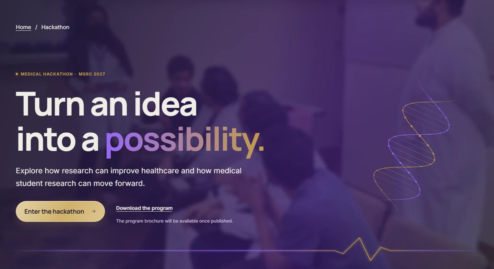
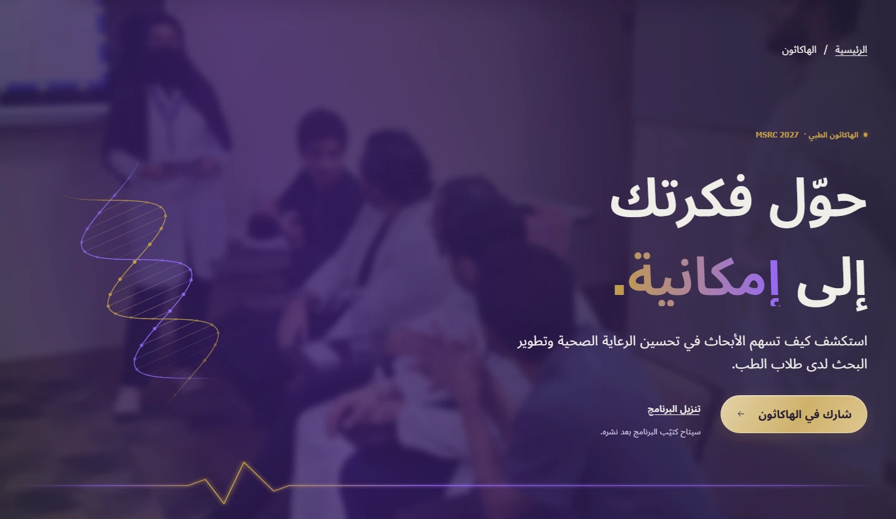

# Hackathon medical-tech — before and after

Baseline: 5ae3c9a, the latest technology-festival revision on PR #101. After: the production build of the medical-tech revision. Chromium at device scale 1, reduced motion, fonts and hero images ready. Screenshots are documentation evidence, not website assets.

The owner chose Option E and then explicitly retained the photographic purple header, its photo and the gold entry pill. DNA and a single ECG beat replace the orbs; two faint echoes have reserved heading cells. Phones keep only the ECG. Track and day cards share dark glass surfaces and fine violet-to-gold edges; step nodes are joined. All existing copy and actions remain; the requested medical-hackathon label is the only added text.

| Locale | Width | Before | After |
| --- | ---: | --- | --- |
| EN | 390px | [Before](before/en-hackathon-390.webp) | [After](after/en-hackathon-390.webp) |
| EN | 1440px | [Before](before/en-hackathon-1440.webp) | [After](after/en-hackathon-1440.webp) |
| EN | 1920px | [Before](before/en-hackathon-1920.webp) | [After](after/en-hackathon-1920.webp) |
| AR | 390px | [Before](before/ar-hackathon-390.webp) | [After](after/ar-hackathon-390.webp) |
| AR | 1440px | [Before](before/ar-hackathon-1440.webp) | [After](after/ar-hackathon-1440.webp) |
| AR | 1920px | [Before](before/ar-hackathon-1920.webp) | [After](after/ar-hackathon-1920.webp) |

## Hero detail

All 30 option-page states were compared: 0 unexpected text changes after excluding the approved label; 0 horizontal-overflow cases. 23/24 other-page screenshots are byte-identical. Hackathon height changes reflect the new label, reserved ECG spacing and quieter card treatment. [Comparison receipt](comparison.json).

The remaining Arabic Workshops phone capture differs by at most one RGB level within the unchanged hero photograph; its text and geometry match.

[Implementation and checks](../../features/hackathon-technology.md).
