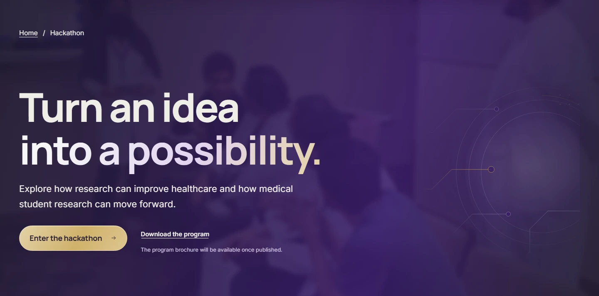
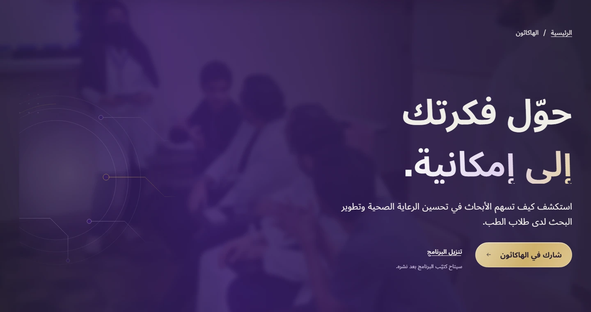

# Hackathon technology — before and after

This gallery records the first version. See the [whole-page follow-up](../hackathon-technology-flow-2026-10-17/README.md) for the current three-piece composition and soft hero edges.

Baseline: `db70b05`. Final images: local production build of this follow-up. Chromium, device scale 1, reduced motion, fonts ready. These are documentation screenshots, not website image assets.

The owner supplied a technology landing-page reference and asked for a restrained interpretation using MSRC branding. A clipped orbital circuit study occupies the empty hero cell. The hero photograph has a deeper purple/ink wash; the Steps watermark is removed to keep only two decorative pieces on desktop and one on phones. The solid dark schedule stays as approved in the later 17 October direction.

| Locale | Width | Before | After |
| --- | ---: | --- | --- |
| EN | 390px | [Before](before/en-hackathon-390.webp) | [After](after/en-hackathon-390.webp) |
| EN | 1440px | [Before](before/en-hackathon-1440.webp) | [After](after/en-hackathon-1440.webp) |
| EN | 1920px | [Before](before/en-hackathon-1920.webp) | [After](after/en-hackathon-1920.webp) |
| AR | 390px | [Before](before/ar-hackathon-390.webp) | [After](after/ar-hackathon-390.webp) |
| AR | 1440px | [Before](before/ar-hackathon-1440.webp) | [After](after/ar-hackathon-1440.webp) |
| AR | 1920px | [Before](before/ar-hackathon-1920.webp) | [After](after/ar-hackathon-1920.webp) |

## Hero detail

All 30 option-page/locale/width combinations were recaptured before and after: 0 text changes, 0 overflow cases, 2 page-height changes. 20/24 screenshots for the other four pages are byte-identical. [Comparison receipt](comparison.json). Full PNG captures remain in the ignored local evidence directory.

[Implementation and verification](../../features/hackathon-technology.md).
