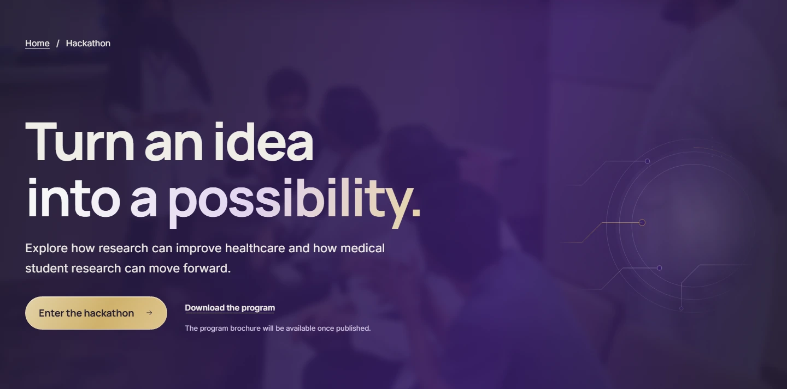
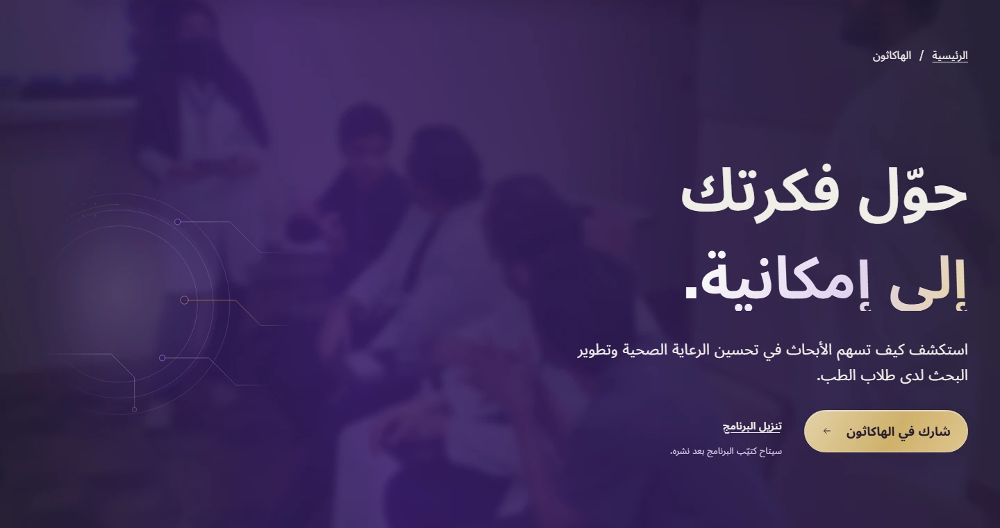

# Hackathon technology flow — before and after

Baseline: `7a09823`, the first technology-theme implementation. After: the local production build of the whole-page follow-up. Chromium, device scale 1, reduced motion, fonts and hero images ready. These are documentation screenshots, not website image assets.

The owner asked for the technology theme to continue through the whole Hackathon page with only a few large pieces, and reported the visible hero cutoff. Three related orbital circuit studies now occupy the hero, Benefits and closing section. Different angles, scale and opposite placement create continuity down the page. Phones retain only the Benefits study. A fade that reaches full transparency at every edge, plus a padded SVG viewBox, removes the hard hero crop. The solid dark schedule stays unchanged.

| Locale | Width | Before | After |
| --- | ---: | --- | --- |
| EN | 390px | [Before](before/en-hackathon-390.webp) | [After](after/en-hackathon-390.webp) |
| EN | 1440px | [Before](before/en-hackathon-1440.webp) | [After](after/en-hackathon-1440.webp) |
| EN | 1920px | [Before](before/en-hackathon-1920.webp) | [After](after/en-hackathon-1920.webp) |
| AR | 390px | [Before](before/ar-hackathon-390.webp) | [After](after/ar-hackathon-390.webp) |
| AR | 1440px | [Before](before/ar-hackathon-1440.webp) | [After](after/ar-hackathon-1440.webp) |
| AR | 1920px | [Before](before/ar-hackathon-1920.webp) | [After](after/ar-hackathon-1920.webp) |

## Hero detail

All 30 option-page/locale/width combinations were compared: 0 text changes, 0 overflow cases, 0 page-height changes. 23/24 screenshots for the other four pages are byte-identical. [Comparison receipt](comparison.json). Full PNG captures remain in the ignored local evidence directory.

The remaining Arabic Workshops phone screenshot differs by at most one RGB level within the unchanged hero photograph; its text and geometry are identical.

[Implementation and verification](../../features/hackathon-technology.md).
