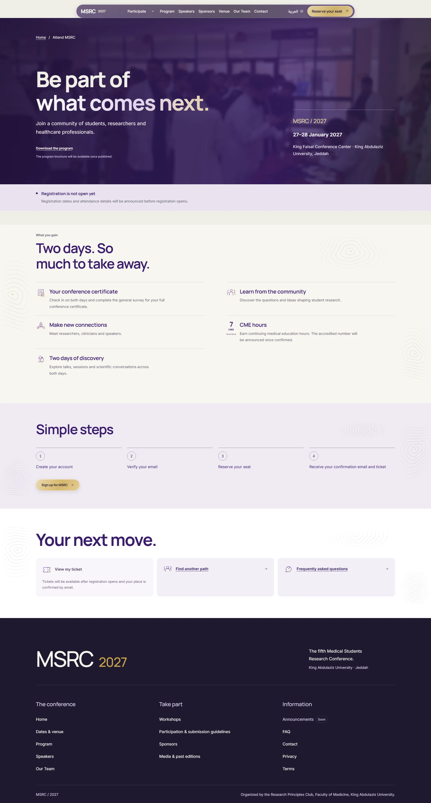
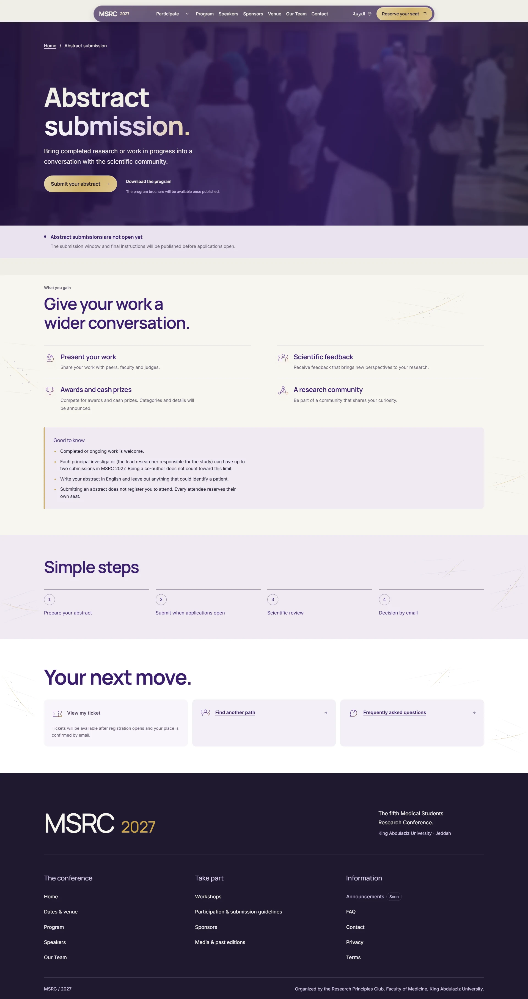
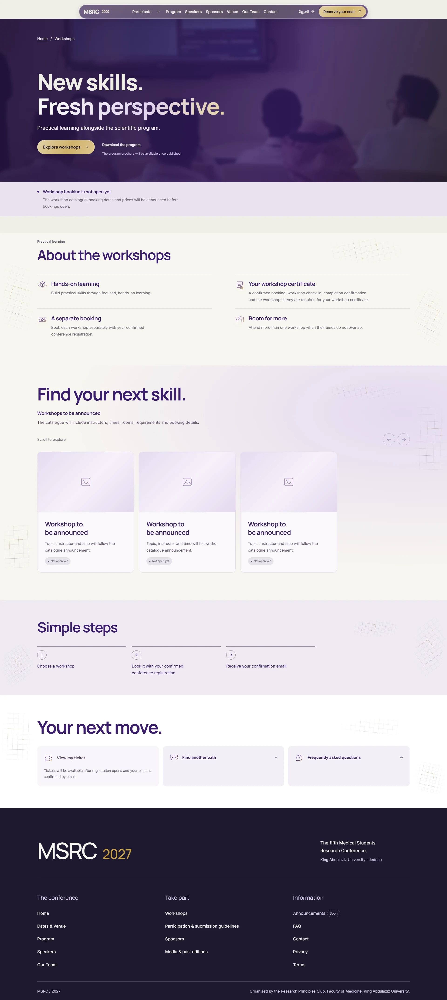
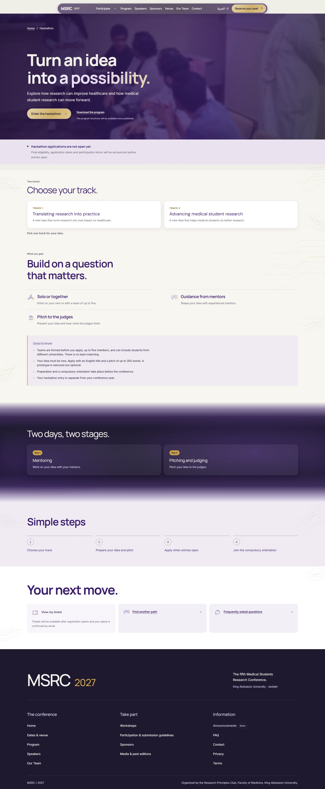
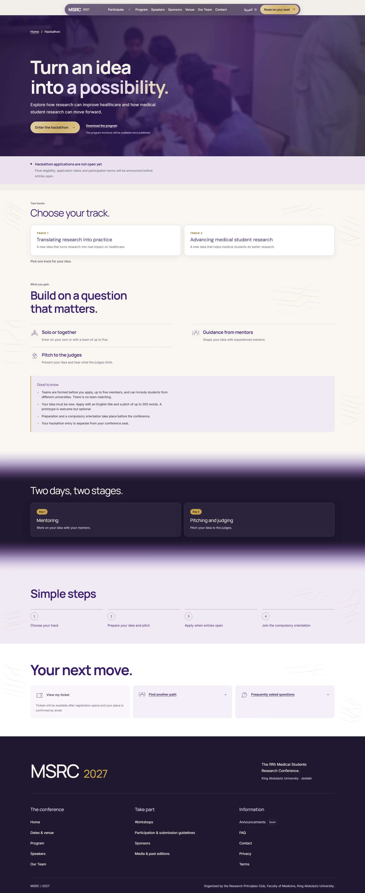
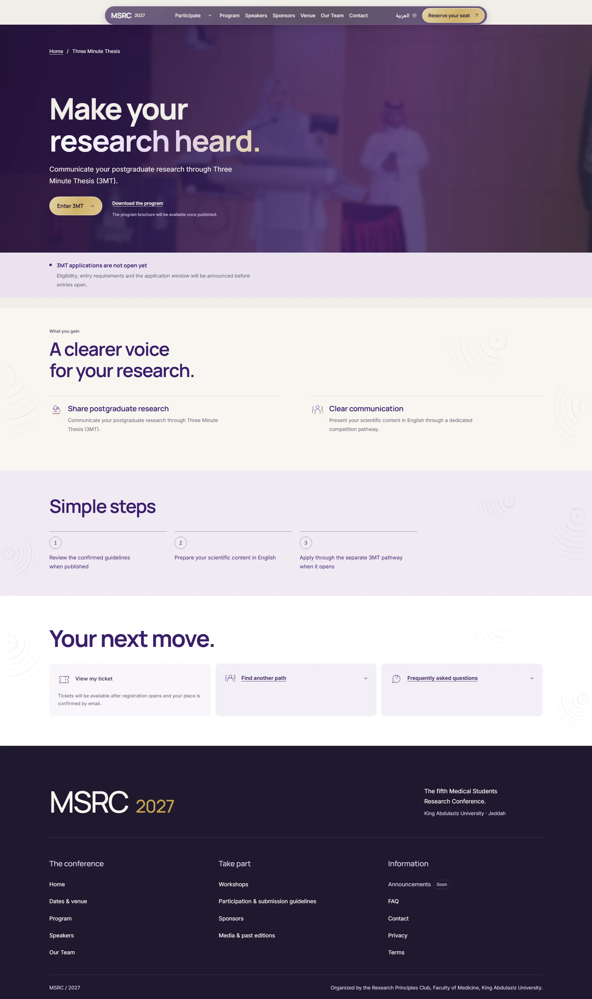
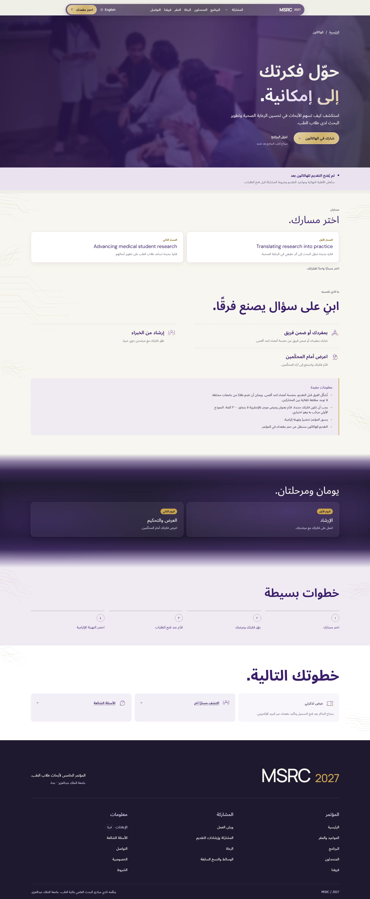
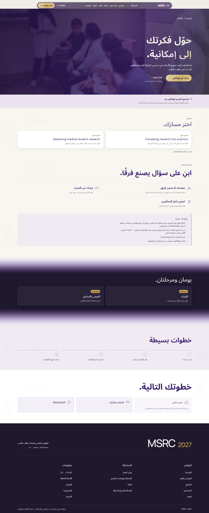

# Participation artwork — before and after

Baseline: `59b21ba`. Final screenshots: local production build of the PR changes.
Chromium, device scale 1, fonts ready, reduced motion. All 30 page/locale/width states were captured before and after; full-size WebP copies preserve the screenshot dimensions. Images here are review evidence, not shipped site assets.

The full gallery below includes 390px phones, 1440px narrow desktop margins, and 1920px wide margins. Additional automated geometry checks cover 1600px and 2560px. [Implementation and verification](../../features/participation-artwork.md).

| Page | Locale | Width | Before | After |
| --- | --- | ---: | --- | --- |
| Attend | EN | 390 | [Before](before/en-registration-390.webp) | [After](after/en-registration-390.webp) |
| Attend | EN | 1440 | [Before](before/en-registration-1440.webp) | [After](after/en-registration-1440.webp) |
| Attend | EN | 1920 | [Before](before/en-registration-1920.webp) | [After](after/en-registration-1920.webp) |
| Attend | AR | 390 | [Before](before/ar-registration-390.webp) | [After](after/ar-registration-390.webp) |
| Attend | AR | 1440 | [Before](before/ar-registration-1440.webp) | [After](after/ar-registration-1440.webp) |
| Attend | AR | 1920 | [Before](before/ar-registration-1920.webp) | [After](after/ar-registration-1920.webp) |
| Abstract submission | EN | 390 | [Before](before/en-submissions-390.webp) | [After](after/en-submissions-390.webp) |
| Abstract submission | EN | 1440 | [Before](before/en-submissions-1440.webp) | [After](after/en-submissions-1440.webp) |
| Abstract submission | EN | 1920 | [Before](before/en-submissions-1920.webp) | [After](after/en-submissions-1920.webp) |
| Abstract submission | AR | 390 | [Before](before/ar-submissions-390.webp) | [After](after/ar-submissions-390.webp) |
| Abstract submission | AR | 1440 | [Before](before/ar-submissions-1440.webp) | [After](after/ar-submissions-1440.webp) |
| Abstract submission | AR | 1920 | [Before](before/ar-submissions-1920.webp) | [After](after/ar-submissions-1920.webp) |
| Workshops | EN | 390 | [Before](before/en-workshops-390.webp) | [After](after/en-workshops-390.webp) |
| Workshops | EN | 1440 | [Before](before/en-workshops-1440.webp) | [After](after/en-workshops-1440.webp) |
| Workshops | EN | 1920 | [Before](before/en-workshops-1920.webp) | [After](after/en-workshops-1920.webp) |
| Workshops | AR | 390 | [Before](before/ar-workshops-390.webp) | [After](after/ar-workshops-390.webp) |
| Workshops | AR | 1440 | [Before](before/ar-workshops-1440.webp) | [After](after/ar-workshops-1440.webp) |
| Workshops | AR | 1920 | [Before](before/ar-workshops-1920.webp) | [After](after/ar-workshops-1920.webp) |
| Hackathon | EN | 390 | [Before](before/en-hackathon-390.webp) | [After](after/en-hackathon-390.webp) |
| Hackathon | EN | 1440 | [Before](before/en-hackathon-1440.webp) | [After](after/en-hackathon-1440.webp) |
| Hackathon | EN | 1920 | [Before](before/en-hackathon-1920.webp) | [After](after/en-hackathon-1920.webp) |
| Hackathon | AR | 390 | [Before](before/ar-hackathon-390.webp) | [After](after/ar-hackathon-390.webp) |
| Hackathon | AR | 1440 | [Before](before/ar-hackathon-1440.webp) | [After](after/ar-hackathon-1440.webp) |
| Hackathon | AR | 1920 | [Before](before/ar-hackathon-1920.webp) | [After](after/ar-hackathon-1920.webp) |
| Three Minute Thesis | EN | 390 | [Before](before/en-3mt-390.webp) | [After](after/en-3mt-390.webp) |
| Three Minute Thesis | EN | 1440 | [Before](before/en-3mt-1440.webp) | [After](after/en-3mt-1440.webp) |
| Three Minute Thesis | EN | 1920 | [Before](before/en-3mt-1920.webp) | [After](after/en-3mt-1920.webp) |
| Three Minute Thesis | AR | 390 | [Before](before/ar-3mt-390.webp) | [After](after/ar-3mt-390.webp) |
| Three Minute Thesis | AR | 1440 | [Before](before/ar-3mt-1440.webp) | [After](after/ar-3mt-1440.webp) |
| Three Minute Thesis | AR | 1920 | [Before](before/ar-3mt-1920.webp) | [After](after/ar-3mt-1920.webp) |

## Wide-screen comparison

### Attend

| Before | After |
| --- | --- |
|  |  |

### Abstract submission

| Before | After |
| --- | --- |
|  |  |

### Workshops

| Before | After |
| --- | --- |
|  |  |

### Hackathon

| Before | After |
| --- | --- |
|  |  |

### Three Minute Thesis

| Before | After |
| --- | --- |
|  |  |

## Arabic and phone examples

| Arabic 1920px — before | Arabic 1920px — after |
| --- | --- |
|  |  |

| Phone 390px — before | Phone 390px — after |
| --- | --- |
|  |  |
