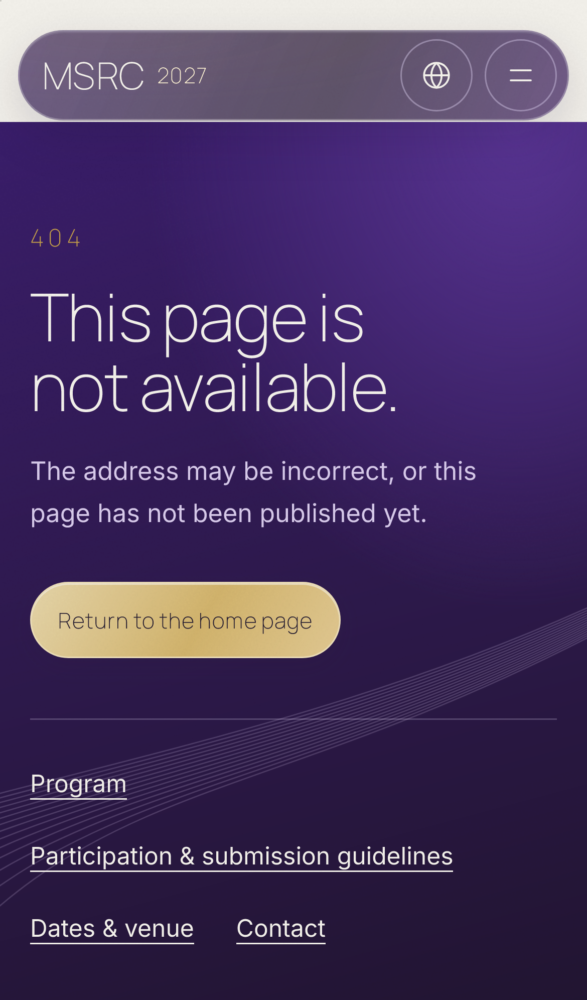
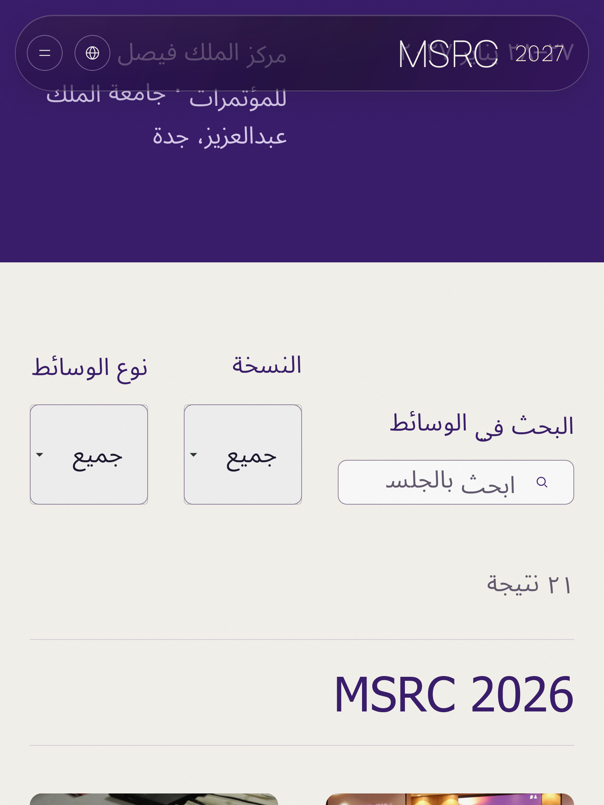
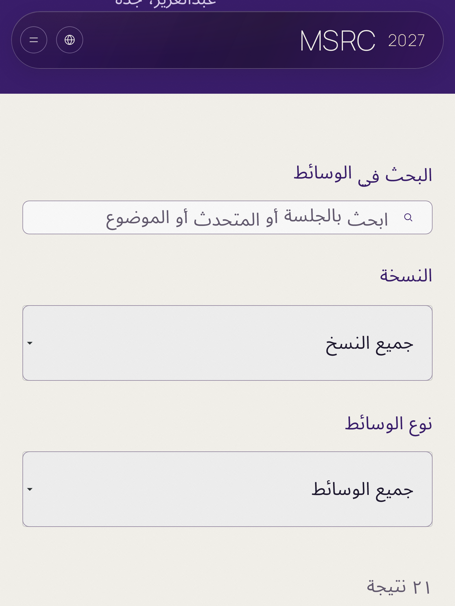

# Real visitor bug hunt — 16 October 2026

Scope: `qa/real-user-bug-hunt`, starting from current main
`a169bfaa50c64d657ef0fd1779caedb226b27f60`. Both GitHub and the Vercel production
alias identified that same revision; deployment `dpl_2CjnPZdnQoAaSEA7wkDo7SPTggVp`.
There were no open PRs at the start. The older dirty handoff checkout was preserved.
No hosted database, settings, workflow gates, content, people, prices or design
direction changed. Contact submissions used only the existing loopback mocks.

This is browser-engine/device emulation on Windows and disposable Linux CI.
Chromium approximates Chrome/Android; WebKit approximates Safari/iPhone/iPad.
It is **not** physical iOS/Android, shipping Safari, or an actual embedded social
app. CSS zoom and enlarged root text are separate probes, not physical pinch zoom
or the OS accessibility text setting. The reported iPhone reload needs hardware
confirmation; no automated crash was observed and no claim of fixing jetsam is made.

## Bugs and disposition

| Page | Device or browser | Steps to reproduce | Expected | Actual on baseline | Severity | Fixed? | Test added |
|---|---|---|---|---|---|---|---|
| Team EN/AR | Phone WebKit/Chromium, also tablet | Enlarge text to 200%; read leaders and committee profiles | Text stays inside a readable card | Portrait/text columns squeeze names into isolated glyphs and spill outside cards | broken | Yes, intrinsic wrapping when content no longer fits | `real-user-media`: Team text bounds, rotation, CSS zoom and document identity |
| Home gallery EN/AR | Keyboard, all engines | Focus album region; press End then Home | Browse last/first photo while keeping the page position | Browser scrolls the whole document; album does not move | confusing | Yes, region-only Home/End and directional arrows; child media/link keys retain defaults | `real-user-media`: album position and unchanged document scroll |
| Header EN/AR | Slow first visit, phone/desktop | Hold JS responses and activate menu/dropdown | JS-only control waits until its handler exists | Enabled control silently does nothing before hydration | confusing | Yes, disabled until hydration, native links retained | `real-user-navigation`: held scripts, readiness and first activation |
| Shared skip link | Safari/iPhone/iPad WebKit | First Tab after direct visit | Focus Skip to content | Link bypassed under WebKit's default Tab policy | confusing | Yes, explicit tabindex zero | `real-user-navigation`: first Tab and Enter reach main |
| `/random` and other unsupported locale roots | All five profiles, JS off | Open `/random` without JavaScript | Visible usable 404 with onward links | HTTP 404 contains an empty error document requiring JS recovery | broken | Yes, restrict locale segment to generated EN/AR params so routing-level 404 runs | `real-user-links`: no-JS root/localized/trailing-slash 404 and home action |
| All localized pages | WebKit | Load any page and inspect console | No unsupported viewport diagnostics | `interactive-widget` viewport hint reports a console error and is ignored | cosmetic | Yes, remove unused fixed-shell hint; preserve zoom and native keyboard scrolling | `real-user-discovery`: zero console errors/warnings on every sitemap page |
| Programme/media EN/AR | iPad WebKit, enlarged Arabic text | At 810px, enlarge text 200%; read native filters | Labels and controls fit the viewport | Arabic programme overflow 13px; media 17px, select text spills | confusing | Yes, existing filter reflow also responds to text-relative container width | `real-user-navigation`: programme/media at tablet width and 200% text |
| Enabled Contact EN/AR, mocks | All five profiles | Submit missing/invalid values with browser language English on Arabic page | Page-language error and focus | Native English popovers accompany localized inline validation | confusing | Yes, suppress native popover while keeping constraint checks and translated inline errors | `contact-delivery`: native invalid events prevented and first invalid control focused |
| Enabled Contact EN/AR, mocks | All five profiles | Submit or refresh an expired token while response/body stalls | Recover with preserved draft and honest retry state | Indefinite sending/preparing, controls disabled | broken | Yes, 30-second response/body deadline; POST remains uncertain, no automatic resend | `contact-delivery`: stalled POST and token refresh, retained draft and explicit retry |
| Enabled Contact server validation | iPad WebKit Arabic; shared form code | Receive a server field error after submitting | Focus the invalid field after controls are enabled | A pre-commit animation-frame focus can target a disabled field and is lost | confusing | Yes, focus requested after React commits the enabled invalid state | `contact-delivery`: repeated server field errors focus the correct enabled control |
| Enabled Contact language switch, mocks | Android Chromium, EN→AR | Type draft then switch language | Preserve data and delivery authority (LOC-01) | Token-keyed route remount clears draft | confusing | Deferred: public Contact is closed. A field-only handoff risks resetting sending/sent/limited/consumed-token state and duplicate delivery. Requires a state-aware memory-only handoff, without PII in URLs/storage. Select language before drafting meanwhile. | Reproduced synthetically; no passing regression falsely claims a fix |
| Rapid native document replacement | Windows WebKit | Navigate away while RSC/bootstrap requests are pending | Clean cancellation and usable destination | Access-control pageerror diagnostics; destinations remain readable | confusing | Investigation retained; same settled 8-route sequence has zero pageerrors. No security weakening, blanket filtering, retries or global prefetch removal applied. Real Safari confirmation needed. | Raw interrupted/settled comparison retained; normal first-activation navigation stays strictly error-checked |

The Contact deadline is client recovery, not delivery confirmation. Existing
server bounds are 3s for admission and 6s for provider work. Aborting a POST cannot
recall an email already accepted by a provider; existing uncertainty/duplicate
warnings and explicit new-attempt controls remain intact. No public copy changed.

The WebKit document-replacement signature has a similar primary upstream report,
whose attribution is also unresolved: [Playwright issue 42823](https://github.com/microsoft/playwright/issues/42823).
Our observed correlation is pending requests plus native document replacement;
the report does not establish a CORS misconfiguration or a user-visible crash.
The errors are retained rather than called a clean live console.

## Coverage and observed evidence

- Live: 28 sitemap URLs (14 pages × EN/AR) across five device profiles and ten
  social user-agent compatibility profiles: **420 visits, all HTTP 200**, no
  failed asset requests, broken images, dead `#` links or observed page crashes.
  Social profiles append representative Instagram, WhatsApp, Snapchat, X and
  LinkedIn tokens to both mobile engine UAs. They do not reproduce native app
  wrappers or claim exact current app UA versions.
- Live raw diagnostics: 224 unsupported-viewport console errors (one per WebKit
  visit) and 253 WebKit fetch access-control reports during interrupted document
  navigation. These are baseline findings, not zero-error production evidence.
- Sharing crawlers: 84 responses, every sitemap page × WhatsApp/Twitterbot/
  LinkedInBot; inspect localized OG title/description/image and large Twitter card.
  Images are 1200×630 PNG. These response checks are not a guarantee of third-party
  cache refresh or native app crop. Existing common artwork is intentionally
  English; no artwork/localized content was invented.
- Live non-sitemap: 40 read-only visits covering EN/AR Contact, registration,
  participant sign-up and staff sign-in across the five profiles. All HTTP 200
  and styled. Contact/registration/participant accounts were closed. Staff sign-in
  was active in production, unlike the default-off local fixture; no credentials
  were entered and no sign-in attempt was made.
- Live JS-disabled error matrix: 20 visits. `/random` was blank in all five
  profiles; `/en/random`, `/ar/random` and `/en/random/` showed the localized 404.
- Existing maps: Google and Apple dispatch their exact approved venue destination
  on the first native click/tap. Each of 13 linked portraits dispatches its exact
  LinkedIn URL. External landing pages are intercepted with deterministic HTML
  after activation; native app handoff, login and provider-side availability are
  manual. Waze, tel and social-profile links are not supplied controls; none added.
- Calendar: EN/AR downloads are attachment `text/calendar`, share one UID, include
  the approved venue, start 27 January and end exclusively 29 January. This is a
  two-day **all-day** event; there is no approved opening instant to assign UTC+3.
  All-day dates avoid device-timezone drift. Native iOS/Android import is manual.
- Exercise programme day/search/reset with rapid changes, language, Back/Forward,
  anchors below the header, menu outside/Escape/rotation/scroll restoration,
  gallery keyboard and synthesized Android native touch, media filters, hero
  explicit pause/rotation/offline/visibility and reduced-motion fallback.
- Countdown uses controlled time and suspended-tab focus; constrained networking
  uses Chromium CDP at 400ms RTT, 50KB/s down and 25KB/s up. Contact mocks cover
  500/503/429, malformed bodies, offline/reconnect, slow response, rapid submit,
  native keyboard constraints, success/reset and no automatic resend.
- BFCache probes returned readable pages, but `pageshow.persisted` was false;
  actual BFCache restoration remains manual. CSS zoom, synthetic visibility and
  engine touch cannot establish physical device memory/keyboard behavior.
- Locale-free `/team` and `/program` follow the existing locale-required route
  contract: a usable English 404. Only the root and configured policy aliases
  redirect by language preference. No new short URL or destination was invented.

## Repeatable checks

Node 24.x, pnpm 11.19.0, locked dependencies. No retries.

```text
npx --yes pnpm@11.19.0 check
# Set REAL_USER_MEDIA_BASE_URL=http://127.0.0.1:3210 for native media tests.
npx --yes pnpm@11.19.0 exec playwright test --config playwright.real-user.config.ts
npx --yes pnpm@11.19.0 exec playwright test --config playwright.contact.config.ts
```

`playwright.real-user.config.ts` starts loopback HTTPS on 3220 backed by production
Next on 3210. Its short-lived self-signed certificate is generated under ignored
`.tools/` with OpenSSL. The browser trusts only this test connection; production
CSP and response headers are forwarded unchanged. This matters because WebKit
honors private-page `upgrade-insecure-requests` even on HTTP loopback. No fixture
strips the security policy. Contact uses its existing isolated 3212/3213/3214
mock servers. Never point a Contact mutation test at production.

WebKit's native media pipeline does not inherit Playwright's trust exception for
the self-signed local certificate. Native public-video checks use the explicit
`REAL_USER_MEDIA_BASE_URL=http://127.0.0.1:3210` override; private-page navigation
stays on HTTPS. Chromium/Android passed 36 original video cases and WebKit passed
36 compatible original video cases over HTTP, including error/preferences/poster,
pause/visibility and autoplay recovery. TLS/native-media failures and interrupted
proxy runs are retained as diagnostic failures, not product failures or passes.

The initial full local check passed lint, types, **2,759 unit cases / 66 files**
and a production build. The stricter network-evidence collector subsequently
passed ten additional unit cases; the full unit run passed **2,769 / 67 files**.
The final frozen source passed `pnpm check`: lint, types, all 2,769 unit cases
and production build, including the skip-link/filter/focus fixes.
Final test-only audit hardening adds nine more negative cases: the complete unit
suite passes **2,778 cases / 67 files**, with lint and TypeScript also passing.
Baseline new regressions failed before fixes: 6 Contact cases,
4 iPhone Team/gallery cases and 2 header readiness cases. Initial 99-case
discovery/link run: 89 passed, 8 failed, 2 skipped; six failures were an overly
strict test locator for duplicate noindex tags, two were the real iPad overflows.
Both causes were corrected without weakening their assertions.

The social-UA interaction run (menu, locale switch and Back added on every page)
recorded 279 passes and one Windows runner `ERR_NO_BUFFER_SPACE` on a local CSS
request with four workers. The failed trace is retained. The HTTPS fixture now
bounds/reuses backend connections (32 active, 16 idle). The affected case passed
after that fixture change; final Linux CI validates the full matrix. No resource error is
ignored and no retry/timeout was added to the tests.

The expanded Contact run completed 169 passes and one iPad Arabic server-error
focus failure in 18.7 minutes. The assertion was retained and the focus ordering
was repaired; final focused replay and CI validate it. This failure is not called
a transient or erased by rerunning the same assertion.

The final five-profile visitor run recorded 318 passes, 22 explicit unsupported
engine/device skips and five failures. Two received the loopback proxy's own 502
document; local transport diagnostics now record the error code and socket state.
The constrained-3G assertion started before JavaScript finished downloading;
its setup now waits for the actual load event before checking enabled controls.
One iPhone language request returned 200 in 67ms and committed after the incidental
5s URL assertion window under parallel load; the unchanged isolated case passed.
The test now awaits the single native activation's URL commit, then checks the
same exact locale, query, hash and filter state. The iPad native video's first
locator attachment consumed most of the autoplay poll budget; setup now awaits
attachment and media readiness before the unchanged playback assertion. Original
failure traces remain preserved. No test timeout, retry, product error filter or
security policy was relaxed.

The first CI pass also retained four Contact profile-job failures: all involved
background Next prefetch requests during intentional offline injection; form
assertions passed. The collector now separates those precise connectivity
failures only while the test has forced offline mode, with same-origin GET,
`_rsc`, RSC and prefetch headers required. HTTP errors, ordinary assets and
online failures still fail. The offline browser cases now deliberately make one
such request so this boundary is exercised every run. All 38 collector unit
cases pass, including 19 added positive/negative offline cases; expected browser
diagnostics remain attached to results.

Targeted final replays passed 20 navigation, four constrained-network, ten native-
video, 33 Contact recovery/focus and ten forced-offline Contact cases. The final
complete unit suite passed **2,797 cases / 67 files**; TypeScript and scoped lint
also passed. An older public motion test expected 200/200ms, while the unchanged
baseline stylesheet already defines 220/280ms. Only that stale expectation was
reconciled; keyboard reopening, focus and current-page assertions are retained.

The hosted Vercel preview built successfully. Browser verification there is
BLOCKED by deployment protection: the connected Vercel fetch returned 403 at
`read_protection_bypass`. No deployment protection, project access or production
setting was changed. Local production builds and disposable CI remain the
automated behavior evidence; preview/hardware checks are owner actions.

CI keeps the existing application/public/database suites and adds three sharded
visitor jobs with Chromium **and WebKit**. Contact has five isolated profile jobs,
each with its own mocks and single worker. Exact-head results and failure artifacts
are recorded by the PR checks; this document does not substitute for those receipts.

## Visual receipts

The [evidence folder](evidence/real-user-bug-hunt-2026-10-16/) contains before/after
Team, no-JS 404 and enlarged iPad filter screenshots. Capture
conditions distinguish live baseline from the fixed local production build.

| Enlarged Arabic Team before | After intrinsic reflow |
|---|---|
|  |  |

| No-JS `/random` live baseline | Fixed local 404 |
|---|---|
|  |  |

| Enlarged Arabic media filters before | After text-relative reflow |
|---|---|
|  |  |

Fixed programme and media measurements are both 810px document width in an 810px
viewport; native selects have 728px client/scroll widths, with no clipped labels.

## Owner phone checklist — about 10 minutes

Run against the PR preview for fixes; the live site retains baseline behavior
until the owner merges/releases. Use an iPhone first; repeat the key steps on Android.

1. **0–2 min:** Open Team EN, scroll through every profile, pinch in/out repeatedly,
   rotate twice, then switch AR and repeat. No reload, blank frame, clipped names
   or lost scrolling. Try the largest OS text size. This is the original crash gate.
2. **2–3 min:** Open/close menu rapidly, outside-tap and Escape with a keyboard if
   available. Follow Contact and return; scroll immediately after closure.
3. **3–4 min:** Programme: Day 2, switch language, Back then Forward. The same day
   and section remain visible below the header. Rotate and use enlarged text.
4. **4–5 min:** Swipe the gallery both ways; pause/play a film; switch apps for a
   few seconds and return. An explicitly paused video stays paused. Repeat with
   Low Power Mode/reduced motion; read the poster when playback is unavailable.
5. **5–6 min:** Open one linked portrait and both Maps choices, then Back. Confirm
   the expected profile/venue and working return navigation. Open mailto to a draft
   and cancel it. Do not send email.
6. **6–7 min:** Download the calendar and import in iOS/Android. Confirm all-day
   27–28 January 2027, approved venue, no shifted day. Do not invent session times.
7. **7–9 min:** Open a shared deep link in Instagram, WhatsApp, Snapchat, X and
   LinkedIn. Check menu, language, portrait link and return. Inspect actual link
   previews/crops. Open `/random` with JS disabled if practical. Save to Home Screen
   and inspect the MSRC name/icon and browser chrome colour.
8. **9–10 min:** Toggle airplane mode on a loaded page, restore it, navigate Back/
   Forward and reload. No persistent blank page. Contact should show its current
   closed state; test keyboard/autofill/submission only in an approved mock setup.

Remaining hardware-only: true pinch-induced process eviction, physical Safari/
Android/installed shortcut, actual software keyboard/autofill, screen reader,
native calendar/maps/mail handoff, actual embedded browsers, Low Power Mode and
true BFCache. Real delivery/authentication were intentionally not exercised.
